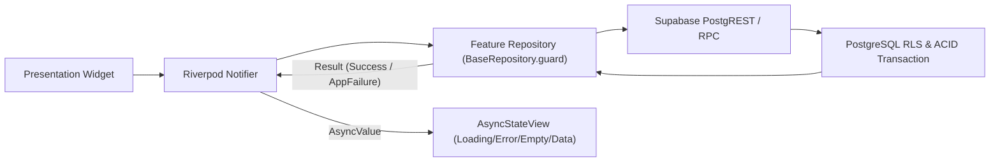

# RITMA — Technical Architecture

## 1. Architectural Style: Modular Monolith

RITMA adopts a **Modular Monolith** architecture on both client (feature-first Flutter app) and backend (Supabase PostgreSQL schema with explicit domain modules, RLS, and transactional RPCs).

**Why Modular Monolith over Microservices:**
- **Transactional Integrity:** Booking a class requires locking session capacity, verifying entitlements, and debiting the credit ledger atomically. In PostgreSQL, this executes inside a single ACID transaction with sub-10ms internal latency—avoiding distributed sagas and eventual consistency bugs.
- **Velocity & Operational Simplicity:** One deployable Flutter codebase (Android, iOS, Web) and one Supabase project per environment (`dev`, `staging`, `prod`) minimizes infrastructure overhead for a lean team.
- **Clean Evolution Path:** Strict domain module boundaries (`identity`, `organization`, `entitlements`, `facility_access`, `booking`, `credit_ledger`, `analytics`) allow extracting heavy workloads (e.g., notification workers or analytics pipelines) into Edge Functions or separate services only when real scale justifies it.

---

## 2. Technology Stack Evaluation & Trade-Offs

### 2.1 Frontend (Flutter & Dart)

| Technology | Role | Decision | Trade-Offs & Justification |
|---|---|---|---|
| **Flutter 3.47+ / Dart 3.13+** | Cross-platform UI (Android, iOS, Web) | **Adopted** | Single codebase delivering native mobile UX for members and front-desk scanners plus responsive web operations dashboards |
| **Riverpod (`flutter_riverpod`)** | Dependency injection & reactive state | **Adopted** | Compile-safe, testable without `BuildContext`, effortless provider overrides for tests and tenant context switching. Deferred `riverpod_generator` initially to keep `build_runner` fast; manual providers remain concise and explicit |
| **GoRouter (`go_router`)** | Declarative & deep-link routing | **Adopted** | Native support for nested `StatefulShellRoute` (separate Member vs Operations navigation shells), auth/role redirect guards, and web URLs |
| **Freezed + JsonSerializable** | Immutable models & sealed failures | **Adopted** | Exhaustive pattern matching on `AppFailure` and state unions, value equality, copyWith, and safe JSON parsing for Supabase DTOs |
| **`package:logging`** | Structured client logging | **Adopted** | Official Dart library, zero external dependency bloat, hierarchical logger names (`ritma.router`, `ritma.booking`), easily wired to remote error reporting later |
| **Drift / SQLite** | Local relational offline cache | **Deferred (Post-MVP)** | Adds native sqlite bundling and sync-conflict complexity. MVP is online-first with clean retry/error states; Drift will be introduced if offline QR check-in queues become a verified customer requirement |

### 2.2 Backend (Supabase Platform)

| Technology | Role | Decision | Trade-Offs & Justification |
|---|---|---|---|
| **Supabase Auth** | Authentication & JWT issuance | **Adopted (Milestone 2)** | Managed email/password, magic link, OAuth, and JWT session refresh integrated natively with PostgreSQL `auth.uid()` |
| **PostgreSQL** | Primary relational database & ACID engine | **Adopted (Milestone 2)** | Strong constraints, partial unique indexes, row-level locking (`FOR UPDATE`), and immutable ledger guarantees |
| **Row Level Security (RLS)** | Multi-tenant & role authorization | **Adopted (Milestone 2)** | Enforces org/branch isolation at the database engine layer regardless of client behavior. Requires disciplined helper functions and indexing on tenant columns |
| **PostgreSQL RPC Functions** | Transactional business engines | **Adopted (Milestone 2)** | Ideal for `validate_and_check_in`, `book_class_session`, `cancel_class_booking`, and `assign_package_to_member` where multi-table atomicity and locking are mandatory |
| **Supabase Realtime** | Live roster, capacity, and front-desk feeds | **Adopted selectively** | Used for live class capacity updates and front-desk check-in streams; respects RLS. Scoped to active screens to control connection usage |
| **Supabase Storage** | Member photos, org logos, class cover media | **Adopted (Milestone 2+)** | Bucket policies enforce tenant-scoped paths (`org_id/...`) and signed URLs for private member photos |
| **Supabase Edge Functions** | External webhooks & secret-bearing integrations | **Adopted only when justified** | Reserved for QR HMAC signing secrets (if kept outside SQL), payment gateway webhooks (Phase 2), and push notification dispatch (Phase 2). Avoid using Edge Functions for simple CRUD already handled by PostgREST + RLS |

### 2.3 Supporting Infrastructure

| Technology | Role | Decision |
|---|---|---|
| **Firebase Cloud Messaging (FCM)** | Push notifications (waitlist promotion, reminders) | **Deferred to Phase 2** |
| **GitHub Actions** | Automated CI (`dart format`, `flutter analyze`, `flutter test`, migration checks) | **Adopted (CI blueprint in DEPLOYMENT.md)** |

---

## 3. Flutter Project Architecture (Feature-First Layered)

```text
lib/
├── main.dart                     # Thin entrypoint invoking bootstrap()
├── app/                          # App-wide composition root
│   ├── app.dart                  # MaterialApp.router, ThemeMode
│   ├── bootstrap.dart            # Logging, global error capture, ProviderScope
│   └── router/                   # GoRouter shells (/member/* vs /ops/*) & guards
├── core/                         # Domain-agnostic shared primitives
│   ├── config/                   # AppEnv (--dart-define), TenantContext
│   ├── errors/                   # AppFailure (Freezed sealed union), ErrorMapper
│   ├── logging/                  # AppLogger (package:logging)
│   ├── repository/               # BaseRepository error-mapping guard
│   ├── result/                   # Result<T> (Success / Failure)
│   ├── theme/                    # Tokens, typography, light/dark, Member/Ops density
│   └── widgets/                  # Shared primitives (AsyncStateView, etc.)
└── features/                     # Isolated vertical feature modules
    ├── foundation/               # Initial verified shell (replaced by auth/dashboard)
    ├── auth/                     # [Milestone 2] Sign-in, session, context switcher
    ├── organizations/            # [Milestone 3] Org, branch, room, staff roles
    ├── members/                  # [Milestone 3] Directory, profiles, status
    ├── packages/                 # [Milestone 4] Gym, class, hybrid catalogs
    ├── entitlements/             # [Milestone 4] Subscriptions, entitlements, credit ledger
    ├── facility_access/          # [Milestone 5] Rotating QR pass, staff scanner, visits
    ├── booking/                  # [Milestone 6] Templates, schedules, bookings, waitlist, attendance
    └── dashboard/                # [Milestone 7] Owner/Branch Manager live KPIs
```

### Layer Responsibilities Inside Each Feature
Each feature follows up to four clear layers (omitting empty layers to avoid unnecessary boilerplate):
1. **`presentation/`**: Widgets, screens, and screen-specific UI controllers (`AsyncNotifier`). Never calls Supabase SDK directly; consumes application providers/repositories.
2. **`application/`**: Orchestration providers and multi-step use cases (e.g., coordinating tenant switching or booking confirmation feedback).
3. **`domain/`**: Pure Dart immutable entities, value objects, enums, and repository abstract interfaces. Zero Flutter/Supabase imports.
4. **`infrastructure/`**: Concrete Supabase/PostgREST/RPC repository implementations and JSON DTO mappers extending `BaseRepository`.

---

## 4. Data Flow & Error Handling



- **Environment Configuration:** Supplied at compile time via `--dart-define` / `--dart-define-from-file` into `AppEnv`. Client builds NEVER embed `SUPABASE_SERVICE_ROLE_KEY` or private signing keys.
- **State Discipline:** Every asynchronous screen explicitly renders Loading, Error (with retry and human-readable `AppFailure.message`), Empty, Offline, and Success states.
