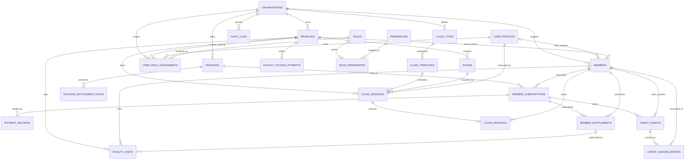

# RITMA — Entity Relationship Diagram (ERD)

This ERD reflects the normalized PostgreSQL schema spanning Multi-Tenant Identity, Membership & Entitlements, Credit Ledger, Facility Access, and Studio Booking.

## Key Relationship Notes

- **Multi-Role Isolation:** `USER_PROFILES` connects to `ORGANIZATIONS` and `BRANCHES` through `USER_ROLE_ASSIGNMENTS` (many-to-many with role & scope). A single user can be `org_owner` in Org A, `instructor` in Org B Branch 2, and a `member` in Org C.
- **Entitlement Decoupling:** `MEMBER_SUBSCRIPTIONS` is the commercial record; it fans out into `MEMBER_ENTITLEMENTS` (for facility access or unlimited class rights) and/or `CREDIT_GRANTS` + `CREDIT_LEDGER_ENTRIES` (for countable class/PT credits).
- **Access Integrity:** `FACILITY_VISITS` links directly to the exact `MEMBER_ENTITLEMENTS` row that authorized entry, guaranteeing post-hoc auditability even if a package definition changes later.
- **Ledger Integrity:** `CLASS_BOOKINGS` references `CREDIT_LEDGER_ENTRIES` via `(reference_type = 'class_booking', reference_id = booking.id)`, linking every consumption and refund directly to its booking lifecycle.
