# RITMA — Entity Relationship Diagram (ERD)

This ERD reflects the normalized PostgreSQL schema spanning Multi-Tenant Identity, Membership & Entitlements, Normalized Eligibility Join Tables, Credit Ledger, Facility Access, Studio Booking, and Post-MVP PT/Equipment/Notifications.

```mermaid
erDiagram
    ORGANIZATIONS ||--o{ BRANCHES : "owns"
    ORGANIZATIONS ||--|| ORGANIZATION_SIGNING_KEYS : "signs_qr_with"
    ORGANIZATIONS ||--o{ MEMBERS : "registers"
    ORGANIZATIONS ||--o{ PACKAGES : "offers"
    ORGANIZATIONS ||--o{ CLASS_TYPES : "defines"
    ORGANIZATIONS ||--o{ USER_ROLE_ASSIGNMENTS : "scopes"
    ORGANIZATIONS ||--o{ AUDIT_LOGS : "records"

    BRANCHES ||--o{ ROOMS : "contains"
    BRANCHES ||--o{ USER_ROLE_ASSIGNMENTS : "scopes_optional"
    BRANCHES ||--o{ CLASS_SESSIONS : "hosts"
    BRANCHES ||--o{ FACILITY_VISITS : "logs"
    BRANCHES ||--o{ FACILITY_ACCESS_ATTEMPTS : "audits"

    USER_PROFILES ||--o{ USER_ROLE_ASSIGNMENTS : "holds"
    ROLES ||--o{ USER_ROLE_ASSIGNMENTS : "assigned_as"
    ROLES ||--o{ ROLE_PERMISSIONS : "grants"
    PERMISSIONS ||--o{ ROLE_PERMISSIONS : "mapped_to"

    USER_PROFILES |o--o{ MEMBERS : "links_optional"
    BRANCHES ||--o{ MEMBERS : "home_branch"

    PACKAGES ||--o{ PACKAGE_ENTITLEMENT_RULES : "provisions"
    PACKAGE_ENTITLEMENT_RULES ||--o{ PACKAGE_RULE_BRANCHES : "scopes_branches"
    PACKAGE_ENTITLEMENT_RULES ||--o{ PACKAGE_RULE_CLASS_TYPES : "scopes_classes"
    PACKAGES ||--o{ MEMBER_SUBSCRIPTIONS : "sold_as"

    MEMBERS ||--o{ MEMBER_SUBSCRIPTIONS : "subscribes"
    MEMBER_SUBSCRIPTIONS ||--o{ PAYMENT_RECORDS : "settled_by"
    MEMBER_SUBSCRIPTIONS ||--o{ MEMBER_ENTITLEMENTS : "materializes"
    MEMBER_SUBSCRIPTIONS ||--o{ CREDIT_GRANTS : "issues"

    MEMBERS ||--o{ MEMBER_ENTITLEMENTS : "possesses"
    MEMBER_ENTITLEMENTS ||--o{ MEMBER_ENTITLEMENT_BRANCHES : "covers_branches"
    MEMBER_ENTITLEMENTS ||--o{ MEMBER_ENTITLEMENT_CLASS_TYPES : "covers_classes"

    MEMBERS ||--o{ CREDIT_GRANTS : "owns_buckets"
    CREDIT_GRANTS ||--o{ CREDIT_GRANT_BRANCHES : "valid_at_branches"
    CREDIT_GRANTS ||--o{ CREDIT_GRANT_CLASS_TYPES : "valid_for_classes"
    CREDIT_GRANTS ||--o{ CREDIT_LEDGER_ENTRIES : "tracked_by"
    MEMBERS ||--o{ CREDIT_LEDGER_ENTRIES : "accounted_in"

    MEMBERS ||--o{ FACILITY_VISITS : "visits"
    MEMBER_ENTITLEMENTS |o--o{ FACILITY_VISITS : "authorized_by"

    CLASS_TYPES ||--o{ CLASS_TEMPLATES : "categorizes"
    CLASS_TEMPLATES ||--o{ CLASS_SESSIONS : "schedules"
    ROOMS ||--o{ CLASS_SESSIONS : "occupied_by"
    USER_PROFILES ||--o{ CLASS_SESSIONS : "instructed_by"

    CLASS_SESSIONS ||--o{ CLASS_BOOKINGS : "reserves"
    MEMBERS ||--o{ CLASS_BOOKINGS : "books"
```

## Key Relationship Notes

- **Composite Tenant Foreign Keys (F1):** Every tenant child relation carries composite FKs including `organization_id` (and `branch_id` where branch-bound, e.g., `ROOMS -> BRANCHES`, `CLASS_SESSIONS -> ROOMS`, `CLASS_BOOKINGS -> CLASS_SESSIONS`), preventing cross-tenant references in SQL.
- **Normalized Scoping (F4):** `PACKAGE_ENTITLEMENT_RULES`, `MEMBER_ENTITLEMENTS`, and `CREDIT_GRANTS` resolve branch and class-type filters through normalized join tables (`*_BRANCHES`, `*_CLASS_TYPES`) with referential integrity instead of untyped UUID arrays.
- **Per-Organization Secrets (F7):** `private.organization_signing_keys` isolates per-tenant QR HMAC keys outside the `public` API schema.
- **Multi-Role Isolation:** `USER_PROFILES` connects to `ORGANIZATIONS` and `BRANCHES` through `USER_ROLE_ASSIGNMENTS`. A single user can be `org_owner` in Org A, `instructor` in Org B Branch 2, and a `member` in Org C.
- **Entitlement Decoupling & Ledger Integrity:** `MEMBER_SUBSCRIPTIONS` materializes into `MEMBER_ENTITLEMENTS` and/or `CREDIT_GRANTS` + append-only `CREDIT_LEDGER_ENTRIES` supporting multi-grant FIFO consumption and per-grant refund tracking.
