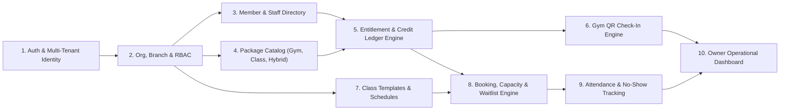

# RITMA — Product Scope & MVP Boundary

## 1. Scoping Philosophy

RITMA is architected for a comprehensive multi-vertical fitness platform, but initial delivery is strictly bounded to a **production-usable MVP** that proves the core unified architecture across both **Traditional Gyms** and **Boutique Studios** without premature infrastructure or unvalidated feature sprawl.

---

## 2. MVP Scope (Phase 1 — Core Unified Operations)

| # | Capability | Included in MVP | Measurable Acceptance Criteria |
|---|---|---|---|
| 1 | **Organization Creation** | Create organization, configure timezone/currency, assign founding Owner | Authenticated user creates an org; Owner role + permissions provisioned atomically; tenant isolated under RLS |
| 2 | **Branch Creation** | Create/edit multiple branches under an org; configure rooms per branch | Owner/Org Admin creates >= 2 branches and rooms; branch-scoped queries return strictly scoped data |
| 3 | **Staff & Member Management** | Invite/assign staff with org or branch-scoped roles; register/search/update members | One user can hold different roles across branches/orgs; member profile created under org with home branch |
| 4 | **Gym Membership Packages** | Create duration-based facility access packages (single-branch, multi-branch, all-branch) | Package defines duration, branch access policy, and price metadata; assignable to members |
| 5 | **Studio Class Packages** | Create credit-based class packs and hybrid (gym + class credit) packages | Package defines credit count, expiry window, and eligible class categories/branches |
| 6 | **Membership & Entitlement Management** | Assign package to member (manual/front-desk recording in MVP), activate, freeze, cancel, view active entitlements & credit ledger | Assigning a gym package creates `facility_access` entitlement only; assigning a class pack posts `grant` entry to `credit_ledger`; hybrid posts both |
| 7 | **Gym QR Check-In** | Member generates signed rotating QR pass; staff scans to validate eligibility and record visit | Eligible member checks in < 800ms; ineligible or expired member denied with explicit reason; double check-in within cooldown window rejected idempotently |
| 8 | **Class Schedules** | Create class templates, rooms, instructor assignments, and scheduled sessions | Branch Manager publishes weekly sessions; sessions display accurate branch, room, instructor, and remaining capacity |
| 9 | **Class Booking** | Member books/cancels classes; staff can book on behalf of member; automatic credit debit/refund | Booking atomically checks entitlement/credits + locks session capacity; concurrent bookings for the last seat produce exactly 1 confirmed booking; timely cancel refunds credit via ledger |
| 10 | **Capacity Management** | Real-time seat limits, full-session enforcement, basic FIFO waitlist | Booking beyond capacity places member on waitlist (if enabled) or rejects cleanly; cancellation promotes waitlist safely |
| 11 | **Attendance** | Instructor/staff marks `checked_in` or `no_show` on session roster | Roster reflects real-time counts; marking `no_show` logs policy event without double-charging credits |
| 12 | **Owner Operational Dashboard** | Real-time KPI summary (active members, today's gym visits, class fill rate, expiring memberships) scoped by org or branch | All metrics computed from live database records (zero fabricated numbers); respects org/branch permission scope |

---

## 3. Explicitly Deferred (Post-MVP Roadmap)

| Capability | Deferred To | Rationale |
|---|---|---|
| **Personal Training Module** (PT availability, 1-on-1 booking, training logs) | Phase 2 | Shares the `credit_ledger` (`pt_credit`) and scheduling primitives built in MVP; deferring keeps MVP focused while preserving schema readiness |
| **Automated Payment Gateways** (Stripe / Midtrans / Xendit webhooks & recurring billing) | Phase 2 | MVP supports manual/offline payment recording with idempotent invoice/payment records so business workflows can be validated before gateway certification |
| **Advanced Finance & Accounting** (tax ledgers, instructor payroll, commission splits, automated refunds) | Phase 3 | Requires stabilized payment gateway settlement flows |
| **Equipment Maintenance & Asset Tracking** | Phase 3 | Operational value-add that does not block core gym/studio launch |
| **Offline-First Local Sync (Drift/SQLite)** | Phase 2/3 | Online-first with resilient retry/caching suffices for MVP; offline check-in cache introduces conflict resolution complexity that should be added intentionally once online workflows stabilize |
| **Push Notifications (FCM) & Automated Campaigns** | Phase 2 | Useful for waitlist promotion alerts and class reminders once booking core is live |
| **AI Intelligence & Churn Prediction** | Phase 4 | Requires real historical visit and booking datasets; never fabricate predictive metrics |

---

## 4. MVP Dependency Chain

---

## 5. Out-of-Scope Guardrails

- **No fake analytics or placeholder KPIs** in production code paths. Demo mode, if enabled in `dev`, must be explicitly flagged via `ENABLE_DEMO_MODE` and visually badged.
- **No single-role shortcuts** (e.g., a `users.role` column) — multi-org, multi-branch role assignments must be built from Day 1.
- **No monolithic "subscription grants everything" logic** — entitlement separation is mandatory from MVP.
