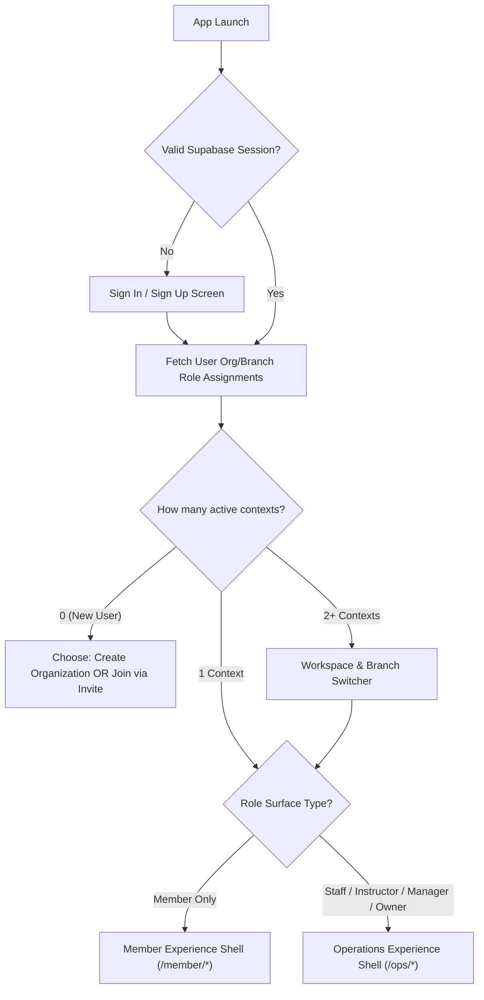
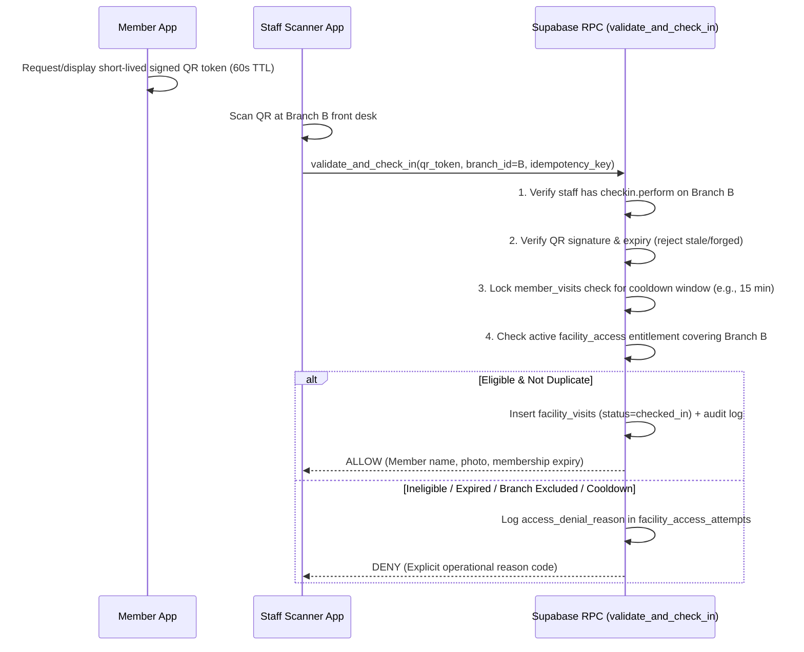

# RITMA — Core User Flows

This document defines the critical operational and member journeys for RITMA, ensuring coherent UX across the **Member Experience** and **Operations Experience** surfaces while preserving strict backend authority.

---

## 1. Authentication & Context Switching Flow

Because a single user can hold multiple roles across organizations and branches, context selection is a first-class flow.

**Key UX Rules:**
- Users with both Staff and Member roles can switch contexts explicitly via the Context Switcher without logging out.
- Switching context clears branch-scoped Riverpod state and re-evaluates router guards immediately.

---

## 2. Organization & Branch Onboarding Flow (Owner)

1. Authenticated user taps **Create Organization**.
2. Enters organization name, business model profile (Traditional Gym, Boutique Studio, Hybrid), default timezone, and currency.
3. Backend RPC `create_organization_with_owner(...)` atomically creates:
   - `organizations` record
   - Default `branches` record (Headquarters / First Branch)
   - `user_role_assignments` granting `org_owner` scope on the organization
   - Audit log entry (`organization.created`)
4. Owner lands in Operations Dashboard with an actionable setup checklist: add rooms, publish first package, invite staff, add first member.

---

## 3. Package Purchase & Entitlement Grant Flow (MVP Manual Recording)

1. Receptionist / Manager opens a Member profile in Operations Experience.
2. Selects **Assign Package** -> chooses a Gym Membership, Class Pack, or Hybrid Package.
3. Confirms start date, eligible branch scope (if package allows selection), and payment status (`paid_cash`, `paid_transfer`, `paid_card_terminal`, `pending`).
4. Client sends an `idempotency_key` to RPC `assign_package_to_member(...)`.
5. Backend transaction:
   - Records `member_subscriptions` and `payment_records` (idempotent on key).
   - If package includes facility access: inserts `member_entitlements` (`entitlement_type = 'facility_access'`, branch access rule, `valid_from`, `valid_until`).
   - If package includes class credits: inserts `credit_ledger` row (`credit_type = 'class_credit'`, `entry_type = 'grant'`, `delta = +N`, `expires_at`).
   - If package includes PT credits: inserts `credit_ledger` row (`credit_type = 'pt_credit'`, `entry_type = 'grant'`, `delta = +N`, `expires_at`).
6. Member immediately sees updated pass status and credit balance in Member Experience.

---

## 4. Gym QR Check-In Flow (Facility Access Engine)

**Edge Cases Handled:**
- Member has 10 Pilates credits but **no** active gym membership -> **DENIED (`NO_FACILITY_ENTITLEMENT`)**.
- Member has Branch A-only gym membership and scans at Branch B -> **DENIED (`BRANCH_NOT_COVERED`)**.
- Member scans twice within 5 minutes -> **REJECTED (`DUPLICATE_CHECKIN_COOLDOWN`)** without creating a second visit record.
- Screenshot of a 10-minute-old QR code -> **DENIED (`QR_TOKEN_EXPIRED`)**.

---

## 5. Class Discovery, Booking & Cancellation Flow (Booking + Credit Ledger)

### 5.1 Booking a Class
1. Member browses schedule filtered by branch, date, class type, or instructor.
2. Member taps **Book Class** on a session (e.g., Reformer Pilates, 1 credit required).
3. Client calls RPC `book_class_session(session_id, member_id, idempotency_key)`.
4. Backend transaction:
   - Verifies actor is the member (or staff with `booking.manage` on the session's branch).
   - Acquires row lock on `class_sessions` (`SELECT ... FOR UPDATE`).
   - Checks member does not already have an active booking for this session.
   - Verifies session is `scheduled` and before booking cutoff.
   - Evaluates class eligibility & computes available unexpired `class_credit` balance (FIFO by soonest `expires_at`, locked on member credit balance/grants).
   - If seats remain (`confirmed_count < capacity`):
     - Inserts `class_bookings` (`status = 'confirmed'`).
     - Posts `credit_ledger` (`entry_type = 'consume'`, `delta = -cost`, referencing `booking_id`).
     - Increments `confirmed_count`.
   - Else if waitlist enabled:
     - Inserts `class_bookings` (`status = 'waitlisted'`, `waitlist_position = next`).
     - Does NOT deduct credit yet (or reserves credit per org policy — MVP deducts on promotion/confirmation with explicit availability check).
5. Member receives instant confirmation or waitlist position.

### 5.2 Cancelling & Waitlist Promotion
1. Member cancels booking via RPC `cancel_class_booking(booking_id, reason)`.
2. Backend locks `class_sessions` and `class_bookings` rows in canonical lock order (`class_sessions` first, then `class_bookings`) to prevent deadlocks.
3. If cancelled before `cancellation_cutoff_at`:
   - Updates booking status to `cancelled_early`.
   - Inserts compensating `credit_ledger` row (`entry_type = 'refund'`, `delta = +cost`, linked to original consume entry).
4. If cancelled after cutoff:
   - Updates booking status to `cancelled_late`; credit is forfeited per studio policy.
5. Waitlist promotion check (in the same or serialized transaction):
   - Selects oldest `waitlisted` member for that session with sufficient unexpired class credits.
   - Atomically promotes booking to `confirmed`, consumes credits in `credit_ledger`, and emits notification event.

---

## 6. Live Class Attendance Flow (Instructor / Staff)

1. Instructor opens **Today's Classes** in Operations Experience -> taps active session.
2. Views roster of confirmed members with booking status and first-time indicator.
3. Taps member row to mark `checked_in` (or `no_show` after grace period).
4. Backend validates `attendance.mark` permission for that branch/instructor assignment, updates `class_bookings.attendance_status`, and writes timestamp + actor ID.
5. After session ends, occupancy rate (`checked_in / capacity` and `confirmed / capacity`) feeds the Owner Dashboard immediately.
